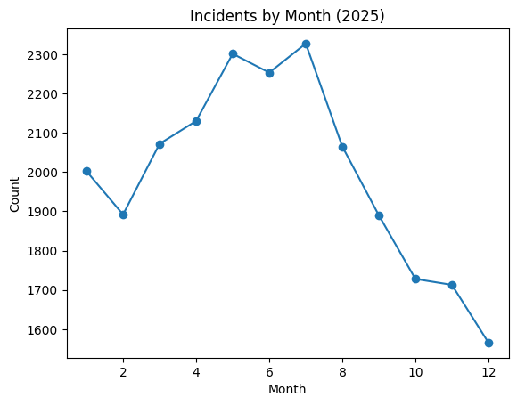
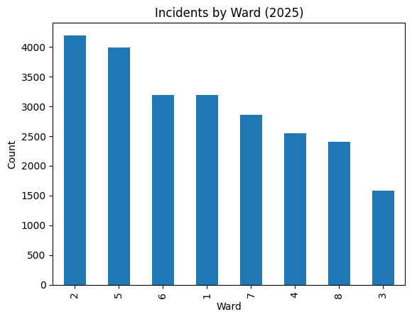
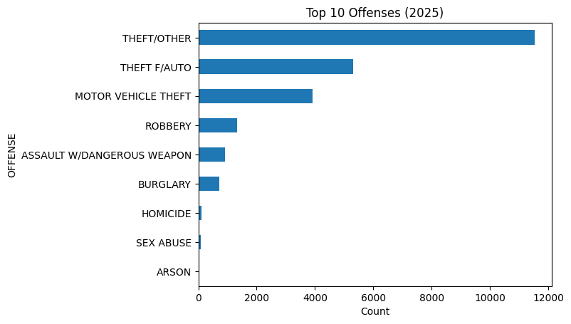
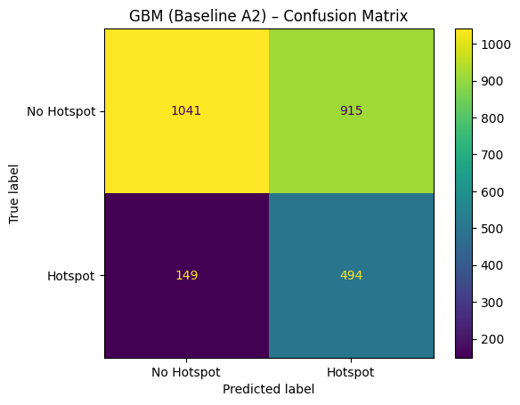
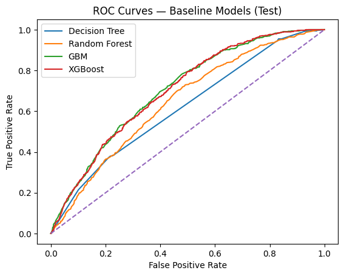
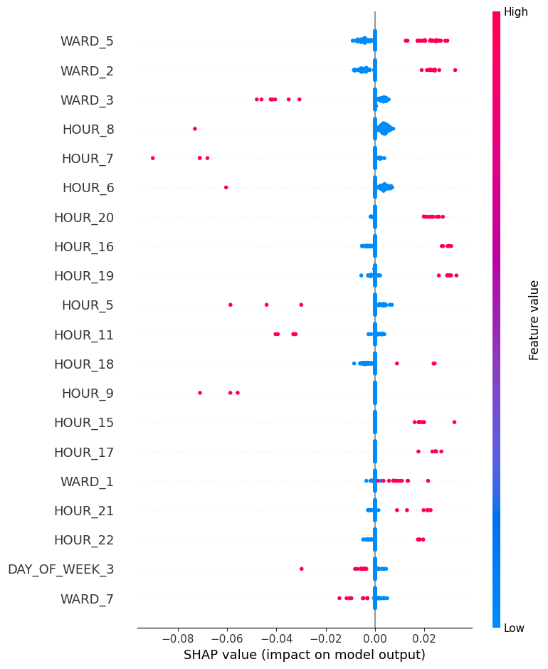

# Crime Hotspot Prediction in Washington, DC

Washington, DC recorded 24,148 crimes in 2025. This project asks a practical question for a police department: which ward, month, day and hour combinations are most likely to see a crime — and can a model flag those hotspots in advance, honestly, with its limits stated?

From Northeastern's ALY6040 Data Mining course (Professor Kasun Samarasinghe). Group 1: Lavanya Suresh, Sushmitha Urs, Abhishek Singh, Dev Panchal. Data: DC Open Data, "Crime Incidents in 2025".

## In plain language

A "hotspot" here is a specific place and time — one ward, in one month, on one day of the week, at one hour — where crimes cluster. The project builds that definition from the data (a ward-hour is a hotspot when its incident count is at or above the 75th percentile, 3 incidents), then trains models to predict it. The models are judged on October 2025 data they never saw during training, after being tuned on September.

The honest headline: the best model catches about 77% of real hotspots, but roughly two of every three hotspots it flags are false alarms. That makes it useful for prioritising patrols — and useless for claiming a crime will definitely happen somewhere.

## The data

- **24,148 incidents, 25 columns** (`data/Crime_Incidents_-_2025.csv`). 2025 records 23,942; a handful are from 2024 (188), earlier years (15) and 2026 (3). Completeness 92.50%.
- **Offences:** THEFT/OTHER 11,649 (48.2%), THEFT FROM AUTO 5,364, MOTOR VEHICLE THEFT 3,937, ROBBERY 1,323, ASSAULT WITH A DANGEROUS WEAPON 925, BURGLARY 719, HOMICIDE 127, SEX ABUSE 100, ARSON 4.
- **Where and when:** Ward 2 has the most crimes (4,225), Ward 3 the fewest (1,598). Evening shift accounts for 41.6% of crimes; July is the highest month.
- **Cleaning:** 0 duplicate rows; 3 duplicate case numbers dropped. One column (OCTO_RECORD_ID) was 100% missing and dropped; BID was 80.1% missing and set to "Unknown". One record had an end date before its start date and was fixed.

## How the prediction is set up

- **Target:** HOTSPOT = incident count ≥ 3 in a ward × month × day-of-week × hour bucket (the training-set 75th percentile).
- **Splits:** train on months up to August (7,631 buckets), validate on September (910), test on October onwards (2,599). Hotspot rates: train 33.52%, validation 29.45%, test 24.74%.
- **Features:** 48 one-hot features (ward, month, day of week, hour, weekend). Decision thresholds were tuned on the validation set (91 values from 0.05 to 0.95, best F1), never on the test set.

## Results — test set, October 2025 onwards

Champion by F1 among the baselines is the **Gradient Boosting Machine (default parameters)**:

| Model | Accuracy | Precision | Recall | F1 | ROC-AUC | PR-AUC |
|---|---|---|---|---|---|---|
| Decision Tree (max depth 6) | 0.3594 | 0.2729 | 0.9549 | 0.4245 | 0.6173 | 0.3192 |
| Random Forest (300 trees) | 0.4686 | 0.2970 | 0.8398 | 0.4388 | 0.6460 | 0.3403 |
| **GBM (default)** | **0.5906** | **0.3506** | **0.7683** | **0.4815** | **0.7041** | **0.4036** |
| XGBoost (400 trees) | 0.5360 | 0.3301 | 0.8507 | 0.4757 | 0.7017 | 0.3952 |

Tuning did not beat the baseline. Tuned AdaBoost (200 estimators, learning rate 1.0) reached accuracy 0.5987 and F1 0.4670; tuned GBM, XGBoost and CatBoost all landed slightly below the baseline GBM's F1 of 0.4815. The final report's own conclusion: "tuning did not significantly improve performance over the baselines. GBM Baseline still leads with the highest F1 (0.4815)."

The boosting comparison (Assignment 3) found AdaBoost best among its own group on F1 (0.4800), ROC-AUC (0.7091) and PR-AUC (0.4083), with CatBoost and LightGBM close behind. A tuned-and-calibrated (Platt scaling) AdaBoost reached F1 0.4779 with Brier score 0.1725. SHAP analysis (100 samples, waterfall and summary plots) shows which ward, hour and weekday features drive the predictions.

## The honest limitation

Precision is about 35%. That means roughly two of every three predicted hotspots are false positives. The tuned GBM and XGBoost each caught 547 of 643 true hotspots (85.1% recall) but produced more than 1,000 false positives each; tuned AdaBoost produced 857 false positives and 186 false negatives. The models are useful for deciding where to send patrols first — not for claiming a hotspot will definitely see a crime. Any report that hides the false-alarm rate is overstating this model.

## What is in this repo

- `assignment-1-eda-and-tree-modeling/` — the Assignment 1 notebook (the `(3)` version is canonical: it runs clean through the Week 2 modelling; its only error cell is a LightGBM environment failure — a missing `libomp` library on the author's Mac, not a code bug) and the EDA report (dated 13 Jan 2026).
- `week-3-adaboost-and-boosting-comparison/` — the standalone AdaBoost notebook and report, the Assignment 3 boosting-comparison report (dated 27 Jan 2026), and the HistGradientBoosting code fragment. Note: the standalone AdaBoost notebook uses a 0.5 decision threshold, unlike the final notebook's tuned thresholds, so its numbers (baseline accuracy 0.7435, F1 0.2942) are **not** comparable to the final notebook's.
- `final-project/` — the final notebook (`final_crime_incident_.ipynb`, 68 cells), the Assignment 6 / Final Project Report (`ALY6040_Final_Report_Group1.docx`, the canonical report), and the companion paper-style write-up `Final_proj1.docx` ("Crime Hotspot Detection Using Ensemble Learning Methods").
- `data/` — `Crime_Incidents_-_2025.csv` (24,148 rows), staged once; identical copies existed in three course folders on the Mac.
- `images/` — 41 real charts: the Assignment 1 EDA question exhibits, the Week 3 AdaBoost charts, and 17 charts extracted from the final notebook (EDA, hotspot-rate research plots, baseline confusion matrix and ROC/PR curves, tuned AdaBoost confusion matrix, calibration curve, SHAP plots).

## How to use it

1. Read `final-project/ALY6040_Final_Report_Group1.docx` for the full write-up, including the data dictionary and the tuning and calibration sections.
2. Run `final-project/final_crime_incident_.ipynb` with `data/Crime_Incidents_-_2025.csv` to reproduce the baselines, the boosting comparison, tuning, calibration and SHAP analysis.
3. Start with `assignment-1-eda-and-tree-modeling/` for the exploratory analysis that motivated the hotspot definition.

## Tools

Python, pandas, scikit-learn (Decision Tree, Random Forest, Gradient Boosting, AdaBoost, HistGradientBoosting), XGBoost, LightGBM, CatBoost, SHAP, matplotlib/seaborn, DC Open Data.

## What was left out, and why

- **Assignment 2 (mushroom classification) and Assignment 4 (MLK "I Have a Dream" wordcloud)** — separate course topics, not part of the crime-hotspot project this repo is titled for. They were read during preparation but deliberately not staged. Note: the mushroom dataset and R code were not found anywhere in the course folder, so they could not have been staged complete in any case.
- **The Week 5 Oscar-data quiz** — an unrelated quiz exercise, not project work.
- **A 57 MB reference PDF** on crime-hotspot detection — over GitHub's 25 MB web-upload limit, and it appears to be a reference paper, not Dev's work. Not claimed as a project deliverable.
- **Other Assignment 1 notebook versions** (the plain version and version `(4)`) — both carry a cell-33 NameError; the staged `(3)` version is the cleanest runnable one. A teammate's EDA notebook and untitled working copies were also left out.
- **Duplicate chart copies** — the five Week 3 Q-charts identical to Week 1's are staged once.

## Conclusion

Crime in DC in 2025 concentrates in specific wards, evenings and summer months, and a gradient boosting model can flag about three-quarters of the real hotspots — at the cost of many false alarms. The project is honest about that trade-off: recall 77% with precision 35% is a patrol-prioritisation tool, not a prediction of individual crimes. Tuning, calibration and SHAP analysis all confirm the same picture — the baseline GBM remains the best model by F1, and no amount of tuning turns a 35%-precision model into a certain one.
